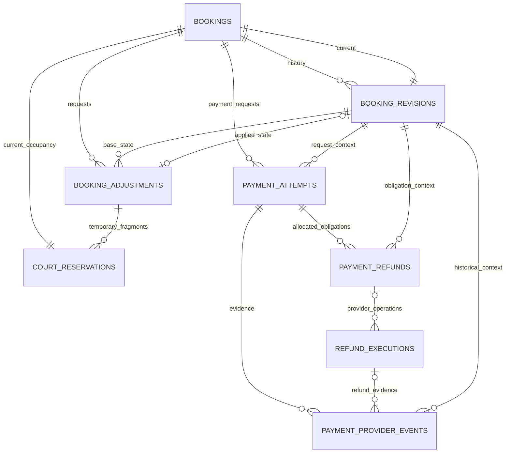

> Implementation status after Task 4C.2: permanent booking identity/ownership,
> immutable revisions, historical transaction context and TypeScript refund allocation
> are implemented, along with immutable authoritative capture receipts and guarded
> payment-request/provider-event facts. Admin management is cancellation-only with
> automatic applicable online refunds. The original inspection findings and financial
> proposals below remain historical design context, not completed capabilities. Later Task 4 work is pending:
> see [remaining financial-model work](payments-memberships.md#remaining-financial-model-work-task-4)
> and [implemented booking contracts](booking-domain.md#implemented-immutable-booking-contracts).
> Booking notifications (Brevo email and its delivery) referenced below were later removed;
> the application now sends no booking notifications.

# Immutable booking revisions and financial history

Original inspection: Phase 1 design review on 2026-10-13 on `feat/booking-financial-immutability`. This document records that review and the superseding implementation status; it does not authorize migration execution.

## 1. Original architecture inspection and problems (historical)

### Inspection scope and authority

Read the repository's `AGENTS.md`, `README.md`, `docs/architecture.md`, booking/payment documentation, entities, repositories, command services, Stripe adapter, migration history, and relevant integration/component/E2E test sources. This inspection used source files, not live database or Stripe account inspection. Historical database findings in `admin-financial-history-fix.md` are prior reported evidence, not newly verified account facts.

The user's approved architecture takes precedence over contradictory older documentation. In particular, older AGENTS database guidance mentions Supabase migrations, while current persistence guidance and runtime use TypeORM; this design uses TypeORM exclusively. Older Phase 6 documentation describes edits without financial side effects; the later paid-adjustment implementation supersedes it. At the original inspection, the registry had opening-hours schedules and booking adjustments beyond the documented 17 entities, and five migration files rather than the documented three. Tasks 1–3 subsequently reconciled metadata and consolidated the disposable development schema into three migrations; the original migration-count finding is historical.

### What exists

| Concern | Inspected implementation | Retain / change |
| --- | --- | --- |
| Permanent commercial identity | `src/lib/db/entities/booking.entity.ts`: unique reservation reference, optional account owner, contact/policy/payment-method snapshots, mutable status and price | Retain identity and owner; move authoritative historical commercial state to revisions |
| Occupancy | `court-reservation.entity.ts`, `reservations.repository.ts`: same-row schedule changes, active/held GiST exclusion, released/cancelled states | Retain; revisions must never participate in occupancy queries |
| Changes awaiting payment | `booking-adjustment.entity.ts`, `booking-adjustments.repository.ts`: request deduplication, target JSON, original/new totals, one pending operation | Retain as workflow request; add explicit base/applied revision links |
| Captures / debts | `payment-attempt.entity.ts`, `payments.repository.ts`: separate initial and surcharge attempts, provider references, requested amounts, statuses, checkout capability | Retain identities; freeze request facts and associate historical booking state |
| Refund obligations | `payment-refund.entity.ts`: allocation per attempt/operation, captured amount snapshot, status, lease, provider generation/history | Retain obligation identity; distinguish provider executions and immutable observations |
| Provider evidence | `payment-provider-event.entity.ts`: globally unique provider/event ID, observed outcome/amount, settlement result, mutable resolution | Extend existing evidence persistence to refund observations and API observations |
| Provider configuration | Settings/change entities and TypeORM configuration service | Retain unchanged; never change historical attempt providers |
| Booking commands | `bookings/service.ts`, `commands.ts`, owner/Admin wrappers | Extend creation/cancellation/owner modification; remove Admin management rescheduling |
| Settlement / recovery | `payments/service.ts`, `booking-adjustments.ts`, `refund-commands.ts`, `refunds.ts`, `admin-reconciliation.ts` | Extend common commands for scheduled and provider-driven recovery |

Creation already commits reservation, booking and attempt atomically. Online checkout initializes Stripe after commit; Pay at club confirms immediately. Modification surcharges create separate attempts and hold only the parts of the target outside original occupancy. A verified surcharge applies a same-row move; inability to apply retains capture evidence and creates a compensation refund. Decreases apply immediately with durable refund obligations, allocated newest capture first. Cancellation refunds remaining captured funds after all existing obligations. These are useful foundations.

### Concrete gaps

1. `executeReschedule()` in `bookings/commands.ts` overwrites the reservation interval and booking total. Same-price and Pay-at-club changes lack adjustment history; price-changing adjustment JSON is incomplete booking history. There is no current-revision pointer or immutable revision entity. Historical financial screens still join the current reservation, court and location.
2. `BookingAdjustmentEntity` cascades from bookings; attempts cascade from bookings; refunds cascade from bookings and attempts; events cascade from attempts. No native historical immutability guards exist. Application discipline alone cannot guarantee preservation.
3. Refund requests and provider executions are conflated. `restartFailedRefund()` clears the provider ID, changes status and generation, and appends JSON history on the same row. A later provider refund therefore replaces the original operation's active identity. Historical failed executions are not first-class relations.
4. `bookingFinancials()` counts only attempt status `succeeded`. Initial late/mismatched captures can live only in provider receipts while an attempt remains expired/cancelled. That evidence must not disappear from verified financial reporting. Conversely, a request amount must not substitute for a mismatched actual amount.
5. Ordinary request/status fields and verified financial facts are mixed. Pay-at-club `due` amount updates are not collected money, yet appear in the transaction projection. Requested refunds are obligations, not completed refunds.
6. `verifyStripeEvent()` accepts PaymentIntent success/failure/cancellation only. Refund updates are ignored. Pending refunds become final only on another invocation. There is no background reconciliation worker; presentation, polling, owner recovery and Admin checks currently drive recovery alongside payment webhooks.
7. Cancellation replay is inferred from an existing cancellation refund. A successful cancellation without a refund cannot replay as success. Record the accepted cancellation revision and decision independently of refund existence.
8. Model drift exists in the additive adjustment migration: entity metadata omits the attempt/refund/reservation adjustment FKs, several adjustment checks, `adjustment_reservation_state`, the adjustment-reservation index, the refund booking index, and refund generation/history/captured-amount checks. `@ForeignKey` represents constraints but the entities generally lack navigable relation properties. Generation must not silently remove native or omitted features.
9. Broad command bodies mix eligibility, pricing projection, refund allocation, persistence and notification preparation. `settleAdjustment()` catches every application exception at a savepoint and treats it as inability to apply, potentially concealing a programming/infrastructure failure.

Existing concurrency protections are valuable: shared configuration fence before location mutexes, aggregate row locks, actor fences, bounded changed-parent retries, lossless stale tokens, post-lock wall time and the court exclusion constraint. Preserve them.

## 2. Original proposed relationships (partially implemented)

Current revision and history are two references to the same revision table. Each booking keeps its existing permanent reservation ID. Changing a booking updates that reservation and the current pointer, while inserting a revision in the same transaction. Historical revisions contain schedule values, not additional active reservation rows. Existing held fragments remain temporary workflow occupancy; they are never booking revisions.

Only two new entities are proposed:

- **BookingRevisionEntity** is necessary because neither mutable bookings/reservations nor optional price adjustments preserve every applied change, including cancellation and equal-price changes.
- **RefundExecutionEntity** is necessary because one refund obligation can require multiple distinct provider operations after a verified failure. One operation must not overwrite another or allocate the obligation twice.

Extend the existing provider-event entity for immutable observations. Do not add a general ledger, double-entry accounts, generic event sourcing, a new backend, or a second payment/refund workflow. Existing operation identities plus immutable receipts support the current court-booking financial history.

## 3. Proposed entities and important fields

Use explicit TypeScript domain types and Zod boundary schemas for revision kind, actor scope, adjustment state, refund/execution processing state, evidence kind/source and provenance. Define them once in domain modules; entities import types rather than owning workflow policy. JSON schemas are versioned, bounded and validated in TypeScript.

### BookingEntity: identity and current projection

Retain `id`, unique `reservationId`, nullable immutable `accountUserId`, `createdAt`, operational `status`, `updatedAt`. Add `currentRevisionId` and TypeORM relations to reservation/current revision/history. Once creation commits, the pointer is non-null and references a revision of this booking.

Move contact, total, currency, cancellation-notice and payment-method authority into revision columns. Current reads join the current revision. Do not keep two writable copies of price/contact/policy. Operational status remains the checkout/hold processing projection; historical state is read from revisions. Expiry/failure can change operational status without pretending a requested reschedule applied.

`accountUserId` remains the sole ownership authority and is never inferred from contact. This task does not introduce ownership transfer. Revision contact is the recipient authority for existing notifications.

### BookingRevisionEntity: append-only snapshot

Important columns:

- UUID `id`, `bookingId`, integer `revisionNumber`, nullable `previousRevisionId`.
- `kind`: `created`, `confirmed`, `rescheduled`, `cancelled`, or `legacy_baseline`; `recordedAt`; nullable `effectiveAt` for legacy unknown timing.
- `actorUserId` nullable for guests/provider/system; `actorScope`: customer, Admin, Coach owner, provider, system, or legacy unknown. Preserve attribution as recorded, not current role/name lookup alone.
- `bookingState` at the accepted operation: pending payment, confirmed, cancelled, or the recorded legacy state. Processing expiry/failure is not retroactively written into a snapshot.
- Fixed `locationId`, `courtId`, local playing date, start/end minute; snapshotted location/court names and timezone, resolved start/end instants for historical display. For legacy rows these metadata describe what is known at cutover, not an invented past name/timezone.
- Customer name/email/phone, total minor units, currency, payment method including legacy NULL, snapshotted cancellation-notice minutes.
- Nullable unique `sourceAdjustmentId`; cancellation attribution/time and explicit `refundDecision` (`automatic`, `admin_refund`, `admin_no_refund`, `not_applicable`, `legacy_unknown`) where applicable.
- `provenance`: newly recorded, legacy observed at cutover, or legacy reconstructed from sufficient evidence; versioned bounded `sourceEvidence` references for imported facts.
- For newly priced creation/reschedules, bounded pricing evidence: court state and selected per-slot rule identity/rate/date scope, rounding version and computed total. Copy facts; do not require a live FK to pricing rows that configuration legitimately replaces/deletes. Cancellation copies previous contractual pricing rather than repricing.

An initial online **creation** revision records an accepted pending checkout request, not a confirmed booking. It is not a pending modification of an existing booking. Confirmation inserts a confirmed revision when policy and verified capture permit it. A pending/failed **reschedule** never inserts a rescheduled revision. Pay-at-club creation starts with a confirmed creation revision. Accepted checkout cancellation intent can insert a cancelled revision even while payment/hold release is unresolved; it never asserts that a capture/refund completed.

Every effective successful modification inserts exactly one new applied revision. A quote, rejected request, duplicate replay or save with identical effective schedule/price/policy/contact is a no-op and creates none. This changes the existing identical-save timestamp behavior intentionally; approval of this no-op interpretation is listed below.

### BookingAdjustmentEntity: existing mutable operation

Retain ID, request key, actor, scope, original/new totals, expiry and status. Add immutable `baseRevisionId`, nullable write-once `appliedRevisionId` and relations. Freeze accepted target/request facts. Replace timestamp-only booking staleness with expected base revision ID; retain the reservation's full-precision token for occupancy concurrency.

Target JSON remains appropriate for a proposal that has not applied, but remove redundant copies of original state when the base revision provides it. Preserve legacy target JSON intact as legacy evidence. Record request-key payload equivalence: reuse with different intent is a conflict, not recovery of an unrelated edit.

Keep legacy `scope=admin` rows for evidence and recovery. New Admin management proposals are forbidden. Equal-price and Pay-at-club changes may create a directly applied adjustment using this same entity for durable request idempotency, with no provider attempt. The applied revision is history; the adjustment is operation identity, not duplicate booking state.

### PaymentAttemptEntity: retain request identity

Retain financial request identity and immutable booking/adjustment/method/provider/amount/currency/creation/deadline facts. Add immutable `bookingRevisionId` (creation or base revision) and `contextProvenance`; add a bounded immutable proposed-state snapshot only when needed for a surcharge's unapplied target, otherwise follow the revision/adjustment relation. A verified event may separately point to the successfully applied revision. Never repoint the original request after a booking changes.

Provider payment ID can attach NULL → exact verified ID once; it cannot be replaced or cleared. Status, local completion time, checkout token hash, retry timing/error and reconciliation claim fields are processing data. Changing these never changes immutable receipt evidence.

Pay-at-club due amounts are explicitly uncollected debt projections. Retain their historical creation request amount; derive current due from the current confirmed revision and any future verified collections. Stop overwriting `amountMinor` on the original due row. No cash collection is fabricated and no cash-payment subsystem is introduced.

### PaymentRefundEntity: retain immutable obligation

Retain existing `id`, `bookingId`, source `paymentAttemptId`, `operationKey`, adjustment link, provider/payment ID, allocated amount/currency, captured-amount snapshot, requester and creation time. Add `bookingRevisionId` for the state causing the obligation; source capture revision remains discoverable through the attempt/receipt. Cancellation links its cancellation revision; reduction links its applied reduced revision; failed-change compensation links the base revision plus unapplied adjustment context.

All obligation terms are immutable. Status/error/retry time/current execution pointer/lease are mutable processing fields. Success is not inferred from requested amount. Freeze legacy generation/history JSON as imported evidence; stop using it as the runtime execution list. Move provider-refund identity authority to executions. Existing provider ID remains preserved as legacy evidence, not a second writable authority.

### RefundExecutionEntity: separate provider refund identity

Fields: UUID `id`, nullable `refundId`, `paymentAttemptId`, `bookingId`, `bookingRevisionId`, `origin` (application or external provider), integer `executionNumber` for application executions, immutable provider/payment/amount/currency tuple, stable `idempotencyKey` for application executions, creation/observation time, nullable write-once `providerRefundId`, provenance, nullable `supersedesExecutionId`, processing status/error/retry/claim timestamps. Application snapshots come from the obligation, never a fresh booking total. An external-origin execution has no fabricated request key/obligation; it requires an established provider reference and verified capture linkage. Keep provider occurrence time separate from local discovery time.

A network retry uses the same execution and key. A verified terminal failed provider operation may, under the existing authorized retry policy, lead to a new execution; the failed row and receipts remain. One obligation remains allocated once regardless of execution count. Do not automatically broaden replacement retry policy for original cancellation refunds: existing adjustment-refund policy and original cancellation policy differ.

### PaymentProviderEventEntity: immutable evidence, mutable handling

Retain `(provider,eventId)` identity and every existing field/value. Add typed `evidenceKind` (payment/refund observation), `source` (signed webhook, verified API response, legacy recorded), provider object type/ID, provider account/mode scope, provider event type/time/API version where available, nullable refund execution link, historical revision link/provenance, and selected balance-transaction/failure fields when supplied by Stripe. Retain the attempt link also for refund evidence so capture linkage is explicit.

Keep requested amount and observed amount distinct. Store both provider outcome and original local settlement result immutably. Existing resolution fields are processing metadata and may be set by the common reconciliation service, without changing original evidence. Do not store client secrets, raw payment-method data or unrestricted provider payloads.

API observations get a separate, deterministic source identity derived from provider scope, object ID and normalized evidence fingerprint; do not impersonate Stripe event IDs. Different observations append new facts; repeats reuse the same fact. Monetary accounting deduplicates by provider operation identity, not receipt count. Multiple Stripe events/API observations about one payment/refund do not become multiple money movements.

## 4. Immutable and mutable boundaries

| Data | Allowed changes |
| --- | --- |
| Booking revision | INSERT only; no UPDATE, DELETE or TRUNCATE |
| Booking identity, owner, original reservation link | Fixed after creation; current revision pointer and processing status can advance |
| Adjustment proposal/actor/request key/base state | Fixed; status, applied pointer once and processing metadata may change |
| Payment attempt financial request | Fixed; provider ID attaches once; operational status/capability/retry metadata may change |
| Refund obligation | Fixed allocated terms, cause and attribution; processing summary may change |
| Refund execution request/provider identity | Fixed request; provider ID attaches once; processing projection may change based on new evidence |
| Provider receipt financial facts/context/received time/original result | INSERT only; only explicitly allowlisted handling/resolution fields can change |
| Court reservation | Current occupancy/lifecycle can change transactionally; no history is sourced from its present schedule |
| Current resource/account configuration | Can change under existing rules; cannot rewrite copied historical facts |

Later provider corrections append observations and retain earlier success/failure facts. A processing projection may change after verified later evidence; a historical fact never changes. In particular, do not let a local rule that “success can never downgrade” suppress a verified later refund failure/return. A delayed stale event alone must not regress a projection: retrieve authoritative current provider state when outcomes conflict, then record both facts. Keep discrepancies visible until genuinely resolved.

Verified cash movements can be reported as distinct captures, distinct successful refund objects and verified refund returns/corrections, linked to their evidence. If no balance-transaction identity is available for an unexpected contradiction, expose an unresolved discrepancy and exclude an invented correction from settled totals. This is a narrow extension of existing receipts, not a general accounting ledger.

## 5. Original proposed integrity and deletion protection

Define entities/relations first with explicit column types, FK names, delete behavior, checks and indexes. Use TypeORM relations with `cascade: false`; do not combine independently generated `@ForeignKey` and relation metadata into duplicate FKs.

Required structural constraints:

1. Unique `(bookingId,revisionNumber)` and `(bookingId,id)` on revisions. Composite FK `(bookings.id,currentRevisionId)` → `(revisions.bookingId,id)` prevents cross-booking pointers. Same-booking composite FKs protect predecessor and adjustment base/applied revision links. Unique predecessor usage prevents branching where a predecessor exists. Initial root and baseline exceptions must be explicit.
2. Handle the booking/current-revision insertion cycle using preallocated IDs and a deferred current-pointer FK, with non-null pointer at commit. Revision → booking FK stays immediate: insert booking, insert revision, commit validates pointer. Only FK deferral needs manual migration supplementation. No automatic SQL revision generation.
3. Unique applied revision per adjustment; request uniqueness `(bookingId,requestKey)`; retain one pending adjustment constraint and enforce stricter unresolved-financial policy in TypeScript. Checks restrict allowed kinds/scopes/states and finite timestamps, valid minute alignment/duration, positive minor amounts, currencies and cancellation-notice bounds. Legacy provenance relaxes only genuinely unknown metadata, not money constraints.
4. Composite FKs bind attempt/refund/event revision links to the same booking; refund source attempt to the same booking; execution to its obligation; receipt execution/attempt relationships to the same financial source. Add candidate unique composite keys required by these FKs. Do not validate the relationships only with service comparisons.
5. Unique `(refundId,executionNumber)`, non-null execution idempotency key and scoped non-null provider refund identity. One unresolved execution per obligation using a partial index. Origin checks require obligation/execution number/key for application executions and a provider reference for external observations; external observations cannot enter the provider-create path. Existing attempt provider/payment uniqueness remains; scope by provider account/mode if more than one can exist. Do not count obligations per execution.
6. Preserve half-open court GiST exclusion for active/held occupancy, the 30-minute fragment exception, existing ordinary 60-minute minimum and held/released fragment-state check. Revisions have no overlap constraint. Coaching occupancy is not implemented; do not create a speculative coaching table here.
7. Replace destructive booking/attempt/refund/event/adjustment cascades with RESTRICT/NO ACTION throughout the history graph, including temporary-fragment adjustment relationships. Financial attribution FKs that currently use SET NULL must become RESTRICT or be supplemented by immutable attribution snapshots with an explicit retention policy; proposed default is RESTRICT. Lease actor is processing attribution and may remain nullable. Archive resources/accounts rather than deleting referenced history.
8. Deny DELETE and TRUNCATE for runtime history tables; add narrow row/statement triggers rejecting revision UPDATE/DELETE/TRUNCATE, financial-record DELETE/TRUNCATE, and changes to immutable column tuples on attempts/refunds/executions/receipts/adjustments. Allow only named processing fields and exact NULL-to-value attachments. PostgreSQL checks these facts; TypeScript still decides transitions, revision contents and policies.

A superuser/schema owner can bypass integrity protection. For production, use a runtime role distinct from the migration owner, with only required grants; browser roles retain no application-table access. No design can protect history against an authorized destructive schema-owner operation. Migration `down` must refuse to discard persisted history; restoration is a separately reviewed data-preserving operation, not silent table drops.

Use QueryBuilder locks, insert/update predicates, returning projections and repository reads wherever they express these operations. Small SQL expressions for advisory locks, full-precision timestamp projections, database wall time, monotonic tokens, deadline predicates, deferred/native constraints and narrow triggers are justified. Full handwritten INSERT/UPDATE/SELECT strings for ordinary CRUD are not. No policy, allocation, expiry loop or reconciliation workflow goes into a SQL function.

## 6. Implemented development migration structure

The original review proposed an additive migration and populated-data backfill.
That proposal was superseded by the approved disposable development/test scope;
no legacy baselines, commercial compatibility columns or historical backfills are
implemented.

TypeORM Data Mapper metadata is the schema authority. The module-scoped DataSource
keeps `synchronize`, `dropSchema` and `migrationsRun` disabled. Exactly three
consolidated migrations define the development schema:

1. `1791462257924-InitialApplicationSchema.ts`: TypeORM-generated application tables,
   constraints and indexes, including booking revisions and adjustment links.
2. `1791462257925-ApplicationNativeIntegrity.ts`: structural ownership/revision and
   financial-context guards, expression index and bootstrap records.
3. `1791462257926-SupabaseAuthStorage.ts`: Auth/Storage integration and browser-role
   security. Supabase's `auth.users` reference is not synchronized by TypeORM.

Native DDL supplements structural integrity/security rather than implementing
pricing, refund allocation or business authorization in SQL. Schema comparison
must propose zero changes after fresh initialization. Use only the guarded local
workflows in [testing](testing.md#isolated-local-integration-and-e2e-environment)
and [README](../README.md#application-migrations-and-fresh-local-setup).
A populated remote/shared cutover remains separately authorized work, not an
implemented migration path or permission to reset such a database.

## 7. Original service responsibilities and transaction proposal

Required flow remains Next.js action/HTTP boundary → TypeScript service → TypeORM repository → entities/EntityManager → PostgreSQL. Repositories never start transactions. All provider/Auth/email calls stay outside transactions. Authorization belongs to application services, with authoritative actor facts rechecked under existing fences.

### Small cohesive responsibilities

| Existing area | Responsibility after implementation |
| --- | --- |
| `bookings/service.ts` | Authorize creation, obtain authoritative quote, orchestrate initial identity/revision/reservation/attempt commit |
| `bookings/commands.ts` | Transaction orchestration and lock order for cancellation and owner modification; delegate pure policy/quote/revision construction |
| Booking revision helper/service | Build complete typed snapshots from validated locked facts; repository inserts them and advances pointer; no independent transaction or workflow framework |
| Existing pricing/calendar helpers | One authoritative quote calculation shared by creation, modification and pending confirmation; use existing rounding/court-state functions |
| Existing adjustment service | Manage proposal, target fragments, capture-to-apply outcome and compensation through common booking/payment commands |
| Existing payment settlement service | Record verified payment evidence, deduplicate, decide booking transition, append confirmation/applied revision and commit atomically |
| Pure financial/refund policy module | Calculate captures, fulfilled/unfulfilled obligations, allocation and retry eligibility from typed facts |
| `refund-commands.ts` / `refunds.ts` | Prepare exact obligation/execution, provider call outside transaction, record observation and update processing projection afterward |
| Existing Admin reconciliation plus narrow scheduled entry | Validate transport authority, select bounded work, invoke the same settlement/refund commands |
| Existing notification service | Prepare snapshots from committed revision transition, send existing Brevo notification after commit |

The revision helper is justified by creation/confirmation/change/cancellation all needing identical snapshot rules. The financial helper is justified by creation/changes/cancellation/reconciliation all needing the same capture and obligation accounting. Neither is a generic aggregate/workflow engine.

### Original cleanup findings (partially resolved)

- Move refund allocation, newest-capture ordering, refund totals and expiry decisions out of `booking-adjustments.repository.ts`. Repositories return/lock facts and insert/update explicit values; TypeScript services decide what to do. `insertAdjustmentAttempt()` must not select Stripe or calculate delta inside persistence; pass approved provider/amount explicitly.
- Replace both `allocateBookingRefund()` and full-refund `insertBookingRefundRequest()` orchestration with one allocator using the same remaining funds/cause rules. The latter currently creates a full attempt-sized obligation without considering other obligations. Keep focused insertion repository methods.
- Remove “latest refund for attempt” ambiguity in `refundForAttempt()` and “first refund by booking” assumptions from reconciliation. Resolve exact operation/execution, or the complete applicable obligation set.
- Centralize initial confirmation and modification quote construction; existing services repeat entity-to-calendar projection and price/hours checks. Preserve distinct publication rules: new public checkout requires publication, owner modification of an existing booking does not.
- Break `executeReschedule()` and `commitSettlement()` into named eligibility, quote, financial-plan and commit steps. Replace blanket savepoint catches with typed expected non-application outcomes; unexpected SQL/integrity errors roll back the settlement so Stripe/worker can retry. Keep savepoint isolation only if needed to preserve a verified capture while an expected GiST/deadline failure prevents application.
- The original review proposed separating provider reconciliation/expiry from presentation reads. Task 3H.2 instead made the narrow cycle correction: adjustment status/cancellation live in `checkout.ts`, `booking-adjustments.ts` imports checkout initialization and re-exports lifecycle helpers, and the pure refund summary lives in `payments/domain.ts`. Neither module has a direct or indirect runtime cycle. A separate recovery-command design remains a proposal, not completed work.
- Convert ordinary raw-SQL repository CRUD/locks to TypeORM. The Admin reporting CTE currently embeds labels/partial-refund classification in SQL and attaches current schedule to past transactions. Prefer bounded ORM operation reads and revision joins with labels/financial summaries in TypeScript. Cross-kind global filtering/pagination must remain correct: merge consistently ordered bounded streams with a common sort/tie-breaker and exact counts; retain a narrowly justified read-only UNION only if ORM cannot express this projection efficiently. Do not page payments/refunds independently and concatenate.

### Common lock contract

For configuration-dependent creation/modification/confirmation: shared configuration advisory fence → ordered location UPDATE locks → booking → permanent reservation → adjustments ordered by ID → payment attempts ordered by ID → provider receipts ordered by scoped identity when locked → refund obligations ordered by ID → executions ordered by ID → existing ordered actor role/account fences when required. Insert revisions under the booking lock; immutable old revisions need no UPDATE lock. Target fragments are locked/released under the same location/booking serialization.

Cancellation omits the configuration advisory fence, retaining location-first aggregate locking, before-start/notice checks and current actor fences. Refund-only result commands do not subsequently acquire an earlier location/aggregate lock. A provider-result command that must apply a booking change begins with the complete location-first contract. Preserve at most three fresh parent-discovery retries. Standardize all callers on the chosen order; do not add a background path that locks a refund then tries to cancel/reschedule a booking.

Current code already locks financial rows by ID in `bookingFinancials()` and locks events/refunds differently in refund commands. Implementation must audit those mixed orders, including multi-attempt cancellation and worker/webhook races, rather than assume old single-attempt order is sufficient.

### Creation and confirmation

Creation transaction validates active account or guest, resources/publication, hours, server quote and provider/pay-at-club eligibility, inserts permanent booking + initial revision + reservation + attempt atomically. Initial online revision is pending; current occupancy is held. Initialize the provider after commit using the persisted attempt identity. Confirmation revalidates policy under locks, records capture evidence and appends a confirmed revision before advancing occupancy to active. Failure/expiry records processing/evidence and releases holds without a fictitious confirmed revision. Notification follows first confirmed transition only.

### Owner modification

Validate owner account, notice snapshot/staff bypass, before-start, fixed location, active resources, base revision ID and lossless reservation token. Resolve authoritative target price/coverage/hours and require explicit acknowledgement when changed. Quotes do not write.

- Same price: atomically insert applied adjustment/revision, move permanent occupancy and advance current pointer. No payment or refund.
- Pay at club: same applied revision transaction; current debt derives from the new revision. No collected payment or refund is asserted.
- Lower online price: calculate remaining eligible captured balance, create applied revision and allocated partial-refund obligations, move occupancy and pointer atomically. Refund fulfillment is asynchronous; it cannot undo the applied revision.
- Higher online price: insert proposal plus surcharge attempt and target hold fragments; current pointer/confirmed occupancy stay unchanged. Verified capture rechecks base revision, actor/policy, deadline and authoritative target pricing. Success releases fragments, moves the permanent row, inserts one revision and advances the pointer in one transaction. Expected non-application records capture and compensation obligation without a revision. Duplicate evidence returns the existing result.

Use existing fixed location and policy rules; no arbitrary customer prices. Changed configuration can invalidate a paid proposal; compensate rather than apply its stale price. Do not duplicate initial checkout implementation for surcharge initialization.

### Cancellation

Under authoritative ownership/Admin rules and post-lock wall time, append a cancellation revision copying the last contractual state and recording actor, effective time and refund decision. Cancel current occupancy, cancel pending modification/release fragments and create required per-capture refund obligations in the same transaction. The current pointer advances to cancellation; earlier confirmed/repriced states remain readable.

Owner and Admin cancellation automatically allocate applicable remaining captured funds and preserve existing notifications. All existing obligations, including pending/failed ones, remain reserved; cancellation allocates only the unreserved remainder. Unknown surcharge capture may arrive later and requires its own compensation obligation, without changing the cancellation decision. A cancelled revision supplies idempotent replay even when no refund was required. Replays do not duplicate revisions, obligations or cancellation mail.

## 8. Stripe and browser-independent reconciliation (deferred Task 4 proposal)

Stripe determines actual payment/refund outcomes; the application determines booking eligibility and obligations. A valid provider response cannot waive notice, take occupied courts or reprice the booking. A local expiry cannot erase a later capture.

Stripe does not guarantee event ordering and can deliver duplicates; event IDs identify replay, while separate events can describe the same object. Extend existing signature verification and normalized TypeScript validation rather than trusting client outcomes. See [Stripe webhook guidance](https://docs.stripe.com/webhooks).

### Provider evidence handling

1. Existing HTTP webhook verifies raw-body signature, provider account/mode, supported event type and identifiers outside the transaction. Add refund-created/updated/failed normalization with refund object amount/currency/payment relationship, status and selected failure/balance evidence. Stripe documents these refund events and failures that return funds later; preserve both earlier and later observations. See [Stripe refunds](https://docs.stripe.com/refunds).
2. Normalize webhook and verified API responses into the same service input, including source identity and historical context. API amount/reference/metadata checks use persisted operation facts; they are never customer-submitted evidence.
3. Insert immutable observation and chosen processing/booking changes atomically. Exact replay returns recorded result without resetting resolution attribution or sending mail again. Same event ID with changed facts rejects. Different event IDs about one provider operation add evidence but do not duplicate a capture/refund or revision.
4. A mismatch stores actual evidence, marks attention and does not apply/auto-refund using the requested amount. Financial views show requested versus observed amount/currency separately. Investigation does not relabel the old receipt as successful matching settlement.
5. For known late exact captures, keep lifecycle/occupancy terminal and create/reuse the proper compensation obligation. Refund completion resolves only evidence fully addressed by that obligation/execution. Partial completion must not resolve an entire capture discrepancy.
6. An externally initiated Stripe refund discovered for a known payment is real evidence. Import its provider identity as an observed execution without claiming the application originally requested it (nullable obligation link for this explicit external-origin case, with capture/revision context). Account for it in available refund capacity before allocating new obligations. Automatic satisfaction of an existing obligation requires unambiguous matching; otherwise leave it for Admin review. Reflect this nullable external-origin relationship in the execution entity/checks rather than creating a fabricated obligation.

### Refund execution and retries

Prepare/claim a persisted execution in a short transaction; retrieve an established refund or recover by metadata before creating; call Stripe outside transactions; append verified response and update projection under the matching execution/claim. A crashed/unknown request retries the same identity. New executions are permitted only after definitive provider failure and authorized retry eligibility, never because a lease timed out.

Retain established legacy idempotency keys and metadata (`payment_refund_id`, `refund_generation`) for existing executions. New executions carry their own identity and stable key plus obligation ID. Stripe's idempotency cache is not permanent; retrieval and paginated metadata recovery remain necessary before any retry creates a refund. See [Stripe idempotent requests](https://docs.stripe.com/api/idempotent_requests).

Scheduled and automatic processing share a token-fenced execution claim; do not retain separate competing leased/unleased implementations. A claim token fences processing decisions, not the truth of provider evidence: a stale caller can still submit a verified observation for its exact execution, but cannot clear a newer claim or create another execution. Before any replacement operation, retrieve the old provider outcome and recalculate remaining capacity under capture/obligation locks. A verified successful execution cannot be retried simply to obtain a different identity.

### Scheduled integration

Add one bounded TypeScript reconciliation entry, invoked by a scheduler-authenticated Next.js Route Handler or the existing server tooling. Choose the deployment scheduler in review. No open browser session, Supabase user session or synthetic Admin actor is required. The HTTP boundary validates a server-only scheduler credential; system authority can process already authorized obligations, never cancel another user's booking or create arbitrary discretionary refunds.

Discover pending/uncertain/unattached attempts, expired/cancelled adjustment attempts needing provider verification, pending/retry refunds and attention-required exact late captures. Persist `nextReconcileAt`, attempt count and token/deadline on existing processing entities, use bounded claims and `SKIP LOCKED`, commit claims, then perform provider calls. Recover attachment by the same original attempt key/metadata; never initialize a second payment for a paid identity. Externally created refunds are discovered through known-payment refund scans as well as webhooks.

Result transactions invoke existing common settlement/refund services. Expiry uses the existing location mutex and TypeScript expiry policy. Claim failures leave durable work reclaimable after expiry; transient failures schedule capped backoff; permanent mismatches stay attention-required. Periodic verification of previously successful refunds is needed because later failure/return can occur; the scheduler's recovery horizon and scan cadence require deployment decisions. Avoid keeping every request permanently pending or depending only on recent event replay retention.

A webhook returns success after durable local handling; post-commit refund execution may be delegated to the scheduler so Stripe delivery does not wait for another Stripe request. Existing direct post-commit attempts remain a latency optimization using the same execution claim. Refund completion does not introduce a new email; preserve current cancellation/confirmation/reschedule notifications.

History totals derive from distinct verified provider money effects, not mutable attempt/refund statuses or receipt counts. Obligation balances derive from allocated obligation terms minus verified fulfillment, with external refunds and returns accounted for explicitly. Legacy locally recorded totals and unverified discrepancies are labelled separately. No “correction” edits an old amount; an actual correcting payment/refund gets a new existing attempt/obligation/execution identity with cause and historical context.

## 9. Current booking permissions and deferred financial implications

| Actor / surface | Current booking behavior / deferred financial work |
| --- | --- |
| Customer owner, My Activity | Keep eligible rescheduling/cancellation, acknowledgement, surcharge payment and reduction refunds; current state uses the accepted revision |
| Guest | Keep initial checkout capability only; no owner rights from email and no new guest self-management |
| Admin managing customer/guest booking | Cancel other customers’ bookings with automatic applicable online refunds and cancellation mail; no management rescheduling |
| Admin financial recovery | Keep exact transaction/refund actions and inspect/reconcile payments after edit window closes; no recovery action secretly creates a new booking change/payment capability |
| Coach managing other customer bookings | Read-only staff booking/contact/occupancy details as currently authorized; no Admin financial management |
| Coach owner of a customer booking | Existing owner services currently allow reschedule/cancel with staff notice bypass; retain as owner capability, separately from management permission |
| Staff-owned direct reservation | Retain existing owner edits, in-progress reason changes and cancellation until end; these are not paid customer bookings |

### Implemented Admin boundary

Admin customer-rescheduling services/actions are removed. The management calendar routes an owned booking through the owner service; another customer’s booking offers Admin cancellation only. Shared owner editing lives in `src/components/booking-edit-form.tsx`. Direct-reservation Admin editing and financial recovery remain separate.

An Admin booking their own court remains a customer owner and may use eligible owner rescheduling, including through My Activity. Management authority never grants rescheduling rights over another account’s booking.

### Coach capabilities inspected separately

`reservation-calendar.tsx` uses creator/account ownership and routes Coach-owned customer bookings through `ownBookingActions`. Coaches can create direct reservations and manage their own direct reservations. Shared staff details are available for customer/guest bookings, but customer management cancellation is Admin-only and management rescheduling is removed; owner mutation is a distinct route. `self-reschedule.ts`, `self-cancellation-service.ts` and `customerBookingNoticeBypass()` authorize active owners and bypass notice for current Admin/Coach roles, always before customer booking start.

Implemented Coach boundary: owner changes and cancellations retain revisions, staff views use revision snapshots, and other-owner mutations and Admin finance remain denied. No expansion of Coach permissions is needed. Removing Coach owner rescheduling or their notice exemption is a separate business decision, not a consequence of removing Admin management rescheduling. Coach availability/assigned coaching sessions are roadmap concepts, not implemented coach-booking persistence in this inspection.

### Read/UI implications

Current bookings join the current revision and permanent occupancy. Historical transaction details show the operation's referenced revision/proposal, separately from the booking's present state. Resource/account renames cannot rewrite historical names/contact. No legacy commercial-history fallback is installed in the disposable schema. Public calendars continue returning occupancy columns only; revisions and financial evidence remain private. Preserve transaction-specific URLs, filters before pagination, 20-row pages and exact operation lookup.

Post-commit email snapshots come from the accepted revision transition. Rejected proposals, quotes and event replays send none. Existing best-effort Brevo behavior has a crash gap between commit and delivery; this design preserves it and does not claim exactly-once durable delivery. A notification outbox would be a separate reviewed requirement.

## 10. Original review sequence and verification plan (historical)

The sequence below records the original review plan, not completion of its financial proposals. The implemented Tasks 1–3H.2 status is stated above; Task 4 financial-model work remains pending. The original populated-data migration step was superseded by the consolidated disposable schema in section 6.

1. **Resolve review decisions and write acceptance cases.** Decide owner role interpretation, no-op semantics, legacy pending Admin adjustments, scheduler and correction scope. Freeze cancellation/refund policy expectations. Output: approved behavior matrix and focused tests planned from actual invariants.
2. **Reconcile affected entity metadata.** Model current adjustment constraints/FKs/indexes and explicit relations accurately without changing live schema. Register all proposed entities in the same module-scoped DataSource. Validate metadata against a disposable database initialized with existing migrations; generation must not propose unrelated changes.
3. **Define domain types and pure planning functions.** Centralize snapshot construction, authoritative booking quote projection, financial evidence summaries/allocation and refund execution eligibility. Reuse existing pricing/notice helpers. Unit cases cover monetary rounding, immutable-context selection, requested/observed mismatch, duplicate evidence and reserved obligation capacity.
4. **Migration scope superseded.** The approved implementation uses the three consolidated development migrations and fresh isolated schema checks in section 6, without an additive patch or backfill. A populated-data deployment is outside the implemented scope.
5. **Implement booking revision writes and current reads.** Creation, confirmation, same-price/Pay-at-club owner change, cancellation and surcharge apply all write one revision/current-pointer transaction. Replace mutable price/contact reads. Use base revision staleness plus retained reservation token. Remove Admin reschedule services/actions; maintain owner/staff separation and direct reservations.
6. **Implement financial boundary and execution persistence.** One TypeScript refund allocator; immutable obligations/executions/receipts; explicit source/cause revisions; stop generation reset and due-amount overwrite. Preserve legacy keys. Port automatic/Admin processing to the common execution claim/result commands. Verify real concurrent allocation and stale-claim behavior.
7. **Extend common provider reconciliation.** Normalize refund events and API evidence; incorporate exact late captures, external refunds and verified corrections; verify operation-based deduplication and mismatch handling. Keep provider network calls outside transactions and handle unexpected failures without concealing them.
8. **Add browser-independent transport.** Scheduler-authorized bounded discovery/claims/backoff invoking the same commands; recover unattached provider initialization and incomplete refunds. Test interrupted execution, duplicate scheduler runs, webhook/worker/Admin races, no browser cookies and no lifecycle reclaim after expiry/cancellation.
9. **Update operation/history views and notifications.** Join historical revisions; distinguish debt/obligation/request from verified transaction; show individual executions and discrepancies, retain existing URLs/pagination. Use current revision for normal booking UI and immutable transition snapshot for existing mail. Update README, AGENTS, architecture, payment and notification docs to the final implementation.
10. **Validate controlled deployment plan.** On disposable infrastructure only, run unit/component checks, targeted then full integration suites, owner paid-adjustment and Admin-cancellation E2E, typecheck/lint/build, schema diff and migration-upgrade checks. Obtain separate authorization for populated cutover/migration execution. Deploy coordinated readers/writers with write pause and preserved backup; stop if counts/evidence/constraints fail validation.

### Existing tests to update

- `tests/integration/db/booking-mutations.integration.test.ts`: retain concurrency, configuration fencing, microsecond deadline, receipt-collision rollback, late capture, notice and lease cases. Replace expectations of overwriting booking price/due amounts, Admin reschedules, identical-save timestamp changes and provider generation reset. Extend the 50 → 75 → 100 → 75 → cancellation case to assert revision chain and historical context of every capture/refund.
- `owner-customer-booking-reschedule.integration.test.ts`, `customer-self-cancellation.integration.test.ts`, `admin-customer-booking-cancellation.integration.test.ts`: add exact immutable revision/actor/cause assertions and replay with no refund. Replace `admin-customer-booking-reschedule.integration.test.ts` positive management cases with server-denial coverage; move shared positive pricing/concurrency cases to owner tests.
- `stripe-payment.integration.test.ts`, `stripe-refunds.integration.test.ts`, `admin-stripe-reconciliation.integration.test.ts`, `payment-foundation.integration.test.ts`: retain provider idempotency/lifecycle protections; assert immutable observations, separate executions, late actual capture visibility and scheduler-independent completion.
- `admin-payment-transactions.integration.test.ts`, relevant Admin payment unit/component tests: operation identity/URL/pagination stay; historical schedule differs from current schedule after edits; external/legacy evidence and multiple execution identities remain visible.
- `tests/integration/db/migration-cutover.integration.test.ts`: add upgrade preservation and entity/schema comparison, not only fresh constraints/grants. Current fixture cleanup and many integration fixtures physically DELETE history; change disposal to guarded isolated database lifecycle or transactional rollback before adding delete guards. Do not disable production triggers/grants as a test shortcut.
- `tests/components/admin-booking-edit-form.test.tsx`, reservation-calendar/booking-history tests and `tests/e2e/booking-adjustments.e2e.ts`: retain owner edit/payment recovery, add Admin cancellation-only and role distinctions. Keep simulated Stripe and blank Brevo credentials.

### Genuine missing invariant scenarios

| Scenario | Required assertion |
| --- | --- |
| Revision append/current pointer failure halfway through move | No revision, occupancy, pointer or obligation partially commits |
| Equal-price, Pay-at-club and cancellation history | Every effective change retained; pending/failed/no-op/replay creates no applied change |
| Raw UPDATE/DELETE/TRUNCATE and parent deletion attempts | Database rejects destruction and immutable-field edits, including cascades and attribution |
| Cross-booking current/base/financial links | Composite constraints reject invalid references |
| Payment → changes → resource rename | Original transaction retains purchased historical state and original amount |
| Distinct webhook events plus API observation for same money | Multiple receipts, exactly one financial effect and applied revision |
| Browser closed before capture/refund completion | Webhook/scheduler completes or flags discrepancy without user session |
| Stripe accepted request, local attach/result failed | Recovery retains original provider identity and never duplicates money |
| Failed refund then permitted replacement | Separate failed/successful executions, one obligation allocation, stale results cannot clear new claim |
| Verified later refund return | Earlier success remains, correction/failure evidence appended, obligation reopened appropriately |
| External partial refund and concurrent cancellation/reduction | Capacity accounts for external money once; no excessive new allocation |
| Refund pending/failed while another change/cancellation races | Locked allocation uses one reserved-funds rule across all workflows |
| Cutover after same-price edits or missing old receipts | Baseline/provenance honest; no reconstructed schedule or Stripe verification fabricated |
| Coach owner versus other booking; Admin owner versus manager | Explicit policy and server authorization, independent of button visibility |

Future validation commands: `npm test`, `npm run typecheck`, `npm run lint`, `npm run test:integration`, `npm run test:e2e -- tests/e2e/booking-adjustments.e2e.ts`, and `npm run build`, following `docs/testing.md` isolation and sequential integration/E2E rules. Extend focused files before running broad suites. No test suite, migration, provider transaction or server command was run for this inspection-only task.

## 11. Original risks and decisions (historical, with resolved booking boundaries)

1. **Historical data cannot be recovered by schema design.** Same-price changes and mutable resource metadata may already have been lost. Approval is needed for baseline/context labels and conditional reconstruction; preserve unknowns rather than invent complete historical revisions.
2. **Owner roles versus Admin management.** Resolved: Admin management rescheduling is removed; eligible Admin/Coach owner workflows and notice exemptions remain.
3. **No-op definition.** Proposed identical effective state returns success without a revision, timestamp rewrite or mail. A deliberate price-only change remains a real revision. If every accepted Save must be evidence even when nothing changes, record an explicit no-op revision kind rather than silently treating it as rescheduling.
4. **Existing pending Admin proposals.** Financial recovery must continue, but whether an already-authorized paid proposal may still apply after cutover is unresolved. The conservative proposal cancels application and compensates verified capture; no migration initiates provider operations.
5. **Refund retry/correction policy.** The implemented policy uses automatic applicable remaining-funds refunds for owner/Admin cancellation, full price-difference reductions and failed adjustment-refund retries. Do not infer cancellation fees, price overrides, discretionary compensation, automatic replacement cancellation refunds or alternative cash refunds. External Stripe operations and provider corrections must be recorded even when automatically fulfilling an application obligation is ambiguous.
6. **Background operation deployment.** Scheduler platform, credential management, batch/time budgets, polling cadence, verification horizon and alert ownership remain to be chosen. Browser-independent reconciliation is required, not optional; deployment must include the actual schedule rather than just an unused Route Handler.
7. **Immutable personal information.** Revision contacts and financial actor attribution require a reviewed retention/anonymization policy before any account-erasure feature. No physical deletion path is proposed for financial history.
8. **Notifications remain best-effort.** Existing post-commit mail can be lost on process failure. Preserve current behavior; if durable retry/exact notification dispatch is required, review a separate narrow outbox extension rather than smuggling it into this design.
9. **Schema-owner power and fixture deletion.** Integrity triggers and RESTRICT cannot constrain a superuser. Production runtime role separation and safe isolated test disposal are required for credible protection.
10. **Coordinated cutover.** Removing writable booking snapshot authority changes many projections and fixture builders. A mixed old/new deployment can overwrite or omit evidence. Complete writers/readers and test the upgrade before any authorized populated deployment.

Booking boundaries above are implemented. Deferred financial execution, observation and scheduler proposals require Task 4 implementation and validation; this historical plan is not evidence of their completion.
